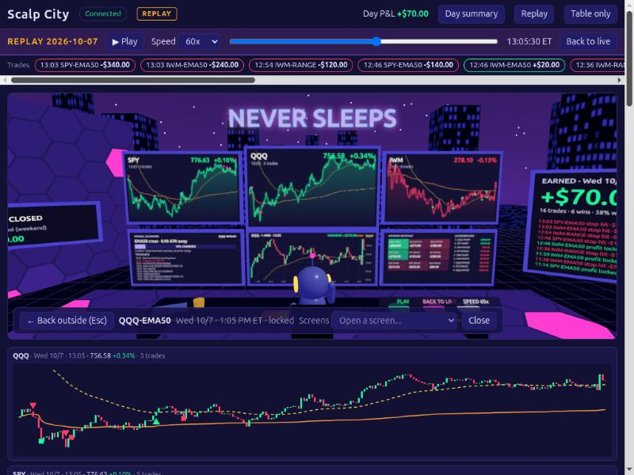
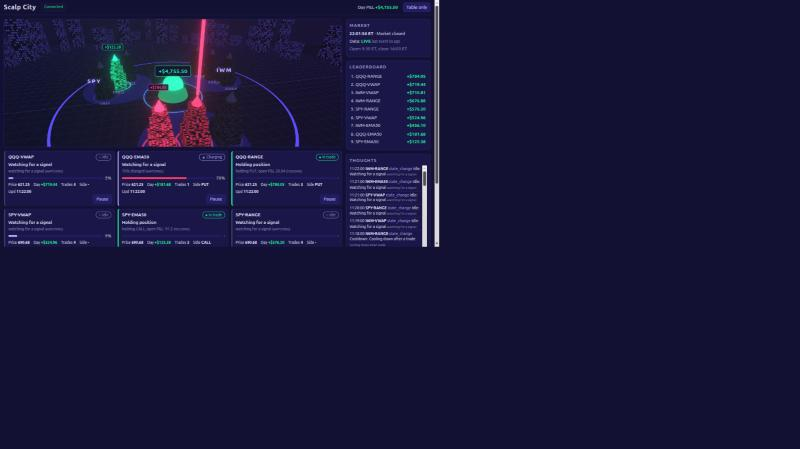
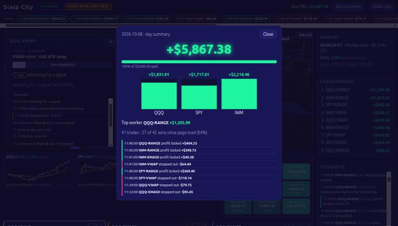
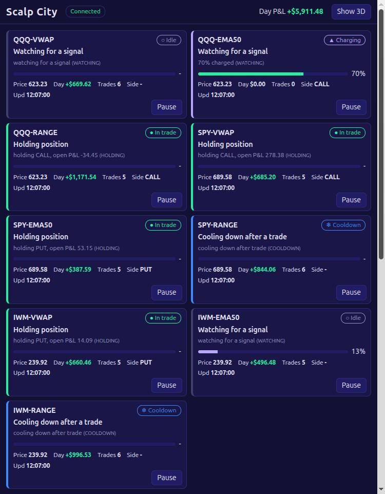

# Scalp City: city view (web3d)

A 3D night-city dashboard for the 9 paper-trading bots (QQQ, SPY, IWM x VWAP, EMA50, RANGE), plus HTML panels
that carry every exact number, so nothing is only visible in 3D. Paper project: this front end never places
orders and never touches keys.

## Run it

```bash
cd web3d
npm install
npm run mock                 # fake engine on http://127.0.0.1:8000 (see flags below)
npm run dev                  # http://localhost:5173 (next free port if taken)
npm test                     # vitest
npm run build                # type check + production build into dist/
```

If port 8000 is busy, run the mock elsewhere and point the dev proxy at it:

```bash
node scripts/mock_stream.mjs --port 8010 --speed 3
VITE_ENGINE_URL=http://127.0.0.1:8010 npm run dev
```

### Mock flags

| flag | default | meaning |
|------|---------|---------|
| `--port N` | 8000 | listen port |
| `--speed N` | 1 | speed multiplier (1 bar = 2 s / N) |
| `--seed N` | 1 | random seed |
| `--no-side` | off | omit the optional `side` field (tests the inference rules) |

The mock plays a synthetic day on a loop: pre-window and range forming, charge rising, fire, hold, every exit
kind, cooldown, a daily-goal lock (QQQ-EMA50), a stale feed (SPY-VWAP), a rejected order (SPY-EMA50), a scripted
pause (IWM-EMA50), and a 4 second disconnect every 120 bars. Pause via the UI works too.

## Point it at the real engine

The page talks to `GET /snapshot`, `WS /ws` and `POST /control/pause` on the same origin. In dev, Vite proxies those
three paths to `VITE_ENGINE_URL` (default `http://127.0.0.1:8000`). For a build served from somewhere else, set
`VITE_API_BASE=http://127.0.0.1:8000` at build time (the engine needs to allow CORS in that case).

Performance: the default look uses additive glow shells and runs at 60 fps on an integrated GPU. Add `?fx=high` to the URL
for the full-screen bloom pass (prettier, but roughly halves the frame rate on integrated graphics).

Measured 60 fps (60.0 to 60.4) in the browser pane at 1024 and 1366 wide, streaming, with and without a tower selected. When
measuring in the pane, take a screenshot first: a sleeping pane throttles `requestAnimationFrame` to 12, 24 or 36 fps
regardless of the page.

Title: `VITE_TITLE=...` at build time, or `?title=Anything` in the URL. Default is "Scalp City".

### If the engine has no websocket

The engine serves `/ws` through uvicorn, which needs the `websockets` (or `wsproto`) package in the engine's Python
environment. Without it `/ws` answers 404. The view then falls back to polling `GET /snapshot` every 2 s (header shows
"Polling every 2 s (no websocket)"): towers, cards, leaderboard, heatmap, dome and charts work; the thoughts feed,
trade tape, badges that depend on closed trades, and mode badge need the event stream. Install `websockets` in the engine's venv
and restart the engine to get everything.

### `/days` and `/day` (engine, replay)

`GET /days` lists logged days (`[{day, mode, events, first, last}]`, newest first); `GET /day?day=2026-10-07&mode=replay` returns
all events of one day. Both are read-only and live in `scalpcity/history.py` and `scalpcity/server.py`. The view's **Replay**
button plays a day through the same reducer as the live stream (speeds 1x to 300x, scrubber, play/pause); live data keeps
running underneath and **Back to live** returns to it. Charts in replay are built from the replayed events (closing prices).

### `/trades` (engine)

`GET /trades?day=2026-10-09&mode=live` returns every closed trade of a logged day, assembled from the event log:
`{bot, ticker, side, contract, qty, entry_time, entry_price, exit_time, exit_price, exit_code, pnl, pnl_day, source}`. `/days` rows
also carry `pnl`, `trades` and `wins`. The view shows them in the **Trades** panel (day picker, bot/ticker/result filters, totals,
CSV download, "Replay this day"), in the trade tape and day summary, and as EARNED cards. If the engine's own day P&L differs from
the sum of logged trades the panel says so (for example after an engine restart reset a bot's running total).

### `/history?day=` (engine, real candles of past days)

`GET /history?ticker=QQQ&day=2026-10-07[&mode=replay]` returns the real one-minute candles of a past day from the Alpaca cache
(`data/cache/stock-QQQ-2026-10-07.json`, written by `scalpcity/alpaca_history.py`) plus that day's levels and markers from its event log.
404 when no bars are cached for that day. `run_live.py --cache-dir` sets the folder (default `data/cache`). In a replay the view fetches this
once and shows candles only up to the replay position; without cached bars it falls back to closing prices from the replayed events.
Cached days today: 2026-10-05, 10-06, 10-07 (not 10-09).

### `/history` (engine)

`GET /history?ticker=QQQ` returns today's one-minute candles, VWAP/EMA levels and trade markers:
`{ticker, bars:[{time,open,high,low,close,volume}], levels:[{time,vwap,ema9,ema21,ema50}], marks:[{time,bot,type,side,pnl}]}`.
Implemented in the engine (`scalpcity/history.py`, wired in `scripts/run_live.py`) and in the mock. Without it the chart
is built only from prices seen since the page loaded.

## What you see

- 3 districts, 3 towers each, with a trigger sign above each tower and a floating badge: "CALL 62% CHARGED",
  "FIRE PUT", "CALL +$44.00", "PROFIT LOCKED +$118.00", "STOPPED OUT -$48.00", "DAILY GOAL", "PAUSED", "STALE DATA".
  Beam height = charge %. Green = CALL, red = PUT, violet = side unknown. On every entry (SIGNAL or ENTRY_FILL event, shown at least 2.5 s even if the engine leaves `fired` in the same bar): a big expanding glowing disc and two rings at the tower base, a tall bright beam flash, a halo and a "FIRE CALL" / "FIRE PUT" burst label; inside the room the firing bot's scanner flashes, the robot throws both arms up and the room light flashes. Under reduced motion: a static ring and label, no flashing. Steady glow in a
  trade, pulsing on exit, blue cooldown, amber locked, hatched grey paused, flickering red stale. Orbit rings spin
  faster on active towers, link lines tie towers to the centre dome. The dome shows total day P&L; click it (or the
  "Day summary" button) for the summary: total, goal bar ($5,000), a bar per ticker, top worker, recent trades.
- Click a tower (in the 3D view), a card or a heatmap tile: the camera flies to that tower, the ticker's full-day
  candle chart floats above it (header "QQQ . Fri 10/9 . 15:59 . 751.27 -0.16% . 20 trades", VWAP and EMA50 lines, CALL/PUT
  entry markers and "+$380.00" exit labels) and a panel opens with the same chart larger, the scanner (headline,
  charge bar, that bot's thoughts in sentences), inputs and Pause/Resume. "Step inside the tower" flies the camera into a
  3D room for that ticker (scanners, charts, heatmap, leaderboard, earned, plaque).
  Esc steps back out, then closes. The chart loads the whole day from `GET /history?ticker=QQQ` (engine) and then
  updates on every bar. On narrow screens the panel sits below the 3D view; on wide screens it overlays the left side.
  Auto-rotation pauses while the pointer is over the 3D view so towers can be clicked.
- Four HUD cards sit at the top-left of the city view: DAY P&L (with goal %), WIN RATE, TRADES and BEST BOT. Click one for the day summary.
- Each tower has a floating billboard: sparkline of its ticker, status ("PROFIT LOCKED +$118", "PUT 40% CHARGED") and
  the bot's day P&L. The clicked tower gets big spinning white rings (a gyroscope) around it. The sky is a starfield with a
  purple horizon.
- Inside the room, **click any screen** (or use the "Open a screen" list, which is keyboard operable): the camera flies to it and a full-size, crisp version opens. Charts zoom with the mouse wheel (time),
  Shift+wheel (price), drag to pan, double-click to reset, with a crosshair and OHLC/VWAP/EMA readout. Keys: `+` `-` zoom,
  arrows pan/zoom price, `0` resets. Esc closes the screen, then leaves the room, then closes the tower.
- **Tower room** (Step inside the tower): one room per ticker, showing only that ticker. Click any tower of a district and its
  ticker's room opens (the clicked bot is highlighted). Neon sign "QQQ TOWER", a robot trader at its desk, hex floor, and eight screens:
  three scanners (one per bot VWAP, EMA50, RANGE: signal, charge bar, thoughts with times, day P&L), a big chart of the ticker with only its
  trade markers, the 1-minute chart with WINNING / LOSING, a heatmap + leaderboard of only that ticker's bots, an EARNED screen with only that
  ticker's trades, and a market plaque with that ticker's day total. Robot mood follows that ticker's P&L. The side panel also lists "QQQ bots
  today" (state and P&L, click to switch bot) and that ticker's recent trades. The screens are monitors (dark bezel, chin with power LED, wall arm or floor stand; keyboard and mouse on the desk). Everything is the live stream filtered to the ticker
  (`src/model/tower.ts`). The three round desk buttons (mapping chosen with you, the video is too small to confirm): green = replay a day / pause / play (Space or P),
  pink = back to live (L), white = cycle speed (S). Hovering a button shows what it does, and it visibly presses in.


- Leaderboard rows, heatmap tiles and trade rows always open that bot (never toggle it off); inside the room they open its scanner.
- Panels: trade tape, three ticker charts (price, VWAP, EMA50, entry/exit markers, % change since page load),
  worker heatmap, 9 bot cards, leaderboard, market clock and data freshness, thoughts feed. "Table only" hides the
  canvas. Every state is also written as text with an icon.
- A header banner shows the data mode from the events: "MOCK DATA, NOT REAL", "REPLAY" or "LIVE PAPER".
- `prefers-reduced-motion` (or `?reduced=1`): no auto-orbit, spinning, flash, pulse, flicker or camera glide; same
  states as static colour.

  

## How the beam colour is decided (CALL vs PUT)

The engine does not send the side yet (see `docs/contract-requests/2026-10-08-side-field.md`). First match wins:

1. `side` field on the event or snapshot row, if present.
2. CALL/PUT parsed from a `SIGNAL` event's reason text ("CALL signal at 123.45"), kept until the trade is over.
3. While forming, VWAP and EMA50 bots only: price below the level means the next cross is up (CALL), above means PUT.
4. Otherwise neutral violet. RANGE bots are neutral while forming until the engine sends `side`.

The drawer marks sides from 2 and 3 as inferred.

## Places where the contract was guessed

1. `side` is not in the engine contract; requested as an optional additive field.
2. The engine's `POST /control/pause` returns `{ok, bot, paused}`, not an event. The row updates from the `control`
   event on the WebSocket; the button shows "..." until then (5 s timeout).
3. `pnl_day` and `trades` are applied from any event that carries them (the engine's own table view only reads
   them from `trade_closed`). The floating P&L label on a tower in a trade shows `pnl_day`; the mock includes the
   open P&L in `pnl_day` while a trade is on.
4. `/history` is an addition to the engine API (see above); the engine only keeps today's bars, and marker sides come from the SIGNAL text.
5. Event `time` is shown as given (ISO, ET); no time zone conversion.
6. Seq going backwards in a snapshot is treated as an engine restart: feed and chart history are cleared.
7. Trade win/loss counts and the tape only cover trades seen since the page loaded (no trade history endpoint).
8. The summary goal is a fixed $5,000 (`DAY_GOAL` in `src/model/summary.ts`).
9. The mock's `mode` is `mock`; the engine's modes are `live` and `replay`.
