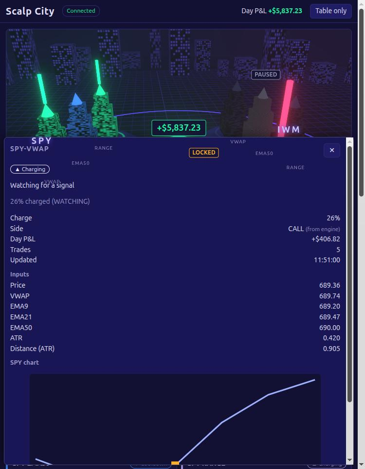

# Scalp City: city view (web3d)

A 3D night-city dashboard for the 9 paper-trading bots (QQQ, SPY, IWM x VWAP, EMA50, RANGE), plus HTML panels
that carry every exact number, so nothing is only visible in 3D. Paper project: this front end never places
orders and never touches keys.


## Run it

```bash
cd web3d
npm install
npm run mock                 # fake engine on http://127.0.0.1:8000 (see flags below)
npm run dev                  # http://localhost:5173 (next free port if taken)
npm test                     # vitest
npm run build                # type check + production build into dist/
```

If port 8000 is busy, run the mock elsewhere and point the dev proxy at it:

```bash
node scripts/mock_stream.mjs --port 8010 --speed 3
VITE_ENGINE_URL=http://127.0.0.1:8010 npm run dev
```

### Mock flags

| flag | default | meaning |
|------|---------|---------|
| `--port N` | 8000 | listen port |
| `--speed N` | 1 | speed multiplier (1 bar = 2 s / N) |
| `--seed N` | 1 | random seed |
| `--no-side` | off | omit the optional `side` field (tests the inference rules) |

The mock plays a synthetic day on a loop: pre-window and range forming, charge rising, fire, hold, every exit
kind, cooldown, a daily-goal lock (QQQ-EMA50), a stale feed (SPY-VWAP), a rejected order (SPY-EMA50), a scripted
pause (IWM-EMA50), and a 4 second disconnect every 120 bars. Pause via the UI works too.

## Point it at the real engine

The page talks to `GET /snapshot`, `WS /ws` and `POST /control/pause` on the same origin. In dev, Vite proxies those
three paths to `VITE_ENGINE_URL` (default `http://127.0.0.1:8000`). For a build served from somewhere else, set
`VITE_API_BASE=http://127.0.0.1:8000` at build time (the engine needs to allow CORS in that case).

Title: `VITE_TITLE=...` at build time, or `?title=Anything` in the URL. Default is "Scalp City".

## What you see

- 3 districts, 3 towers each. Beam height = charge %. Green = CALL, red = PUT, violet = side unknown.
  Ring flash on fire, steady glow in a trade (with day P&L label), pulsing on exit, blue cooldown,
  amber locked, hatched grey paused, flickering red stale. Centre dome = total day P&L.
- Orbit with the mouse, click a tower or a card to open the detail drawer (inputs and a price chart). Esc closes.
- Panels: 9 bot cards (with Pause/Resume), thoughts feed (non-tick events), leaderboard, market clock and
  data freshness. "Table only" hides the canvas. Every state is also written as text with an icon.
- `prefers-reduced-motion` (or `?reduced=1`): no auto-orbit, flash, pulse or flicker; same states as static colour.

 

## How the beam colour is decided (CALL vs PUT)

The engine does not send the side yet (see `docs/contract-requests/2026-10-08-side-field.md`). First match wins:

1. `side` field on the event or snapshot row, if present.
2. CALL/PUT parsed from a `SIGNAL` event's reason text ("CALL signal at 123.45"), kept until the trade is over.
3. While forming, VWAP and EMA50 bots only: price below the level means the next cross is up (CALL), above means PUT.
4. Otherwise neutral violet. RANGE bots are neutral while forming until the engine sends `side`.

The drawer marks sides from 2 and 3 as inferred.

## Places where the contract was guessed

1. `side` is not in the engine contract; requested as an optional additive field.
2. The engine's `POST /control/pause` returns `{ok, bot, paused}`, not an event. The row updates from the `control`
   event on the WebSocket; the button shows "..." until then (5 s timeout).
3. `pnl_day` and `trades` are applied from any event that carries them (the engine's own table view only reads
   them from `trade_closed`). The floating P&L label on a tower in a trade shows `pnl_day`; the mock includes the
   open P&L in `pnl_day` while a trade is on.
4. There is no price history endpoint, so the ticker chart only holds ticks seen since the page loaded.
5. Event `time` is shown as given (ISO, ET); no time zone conversion.
6. Seq going backwards in a snapshot is treated as an engine restart: feed and chart history are cleared.
7. The spec's heatmap is not built (not in the brief).
